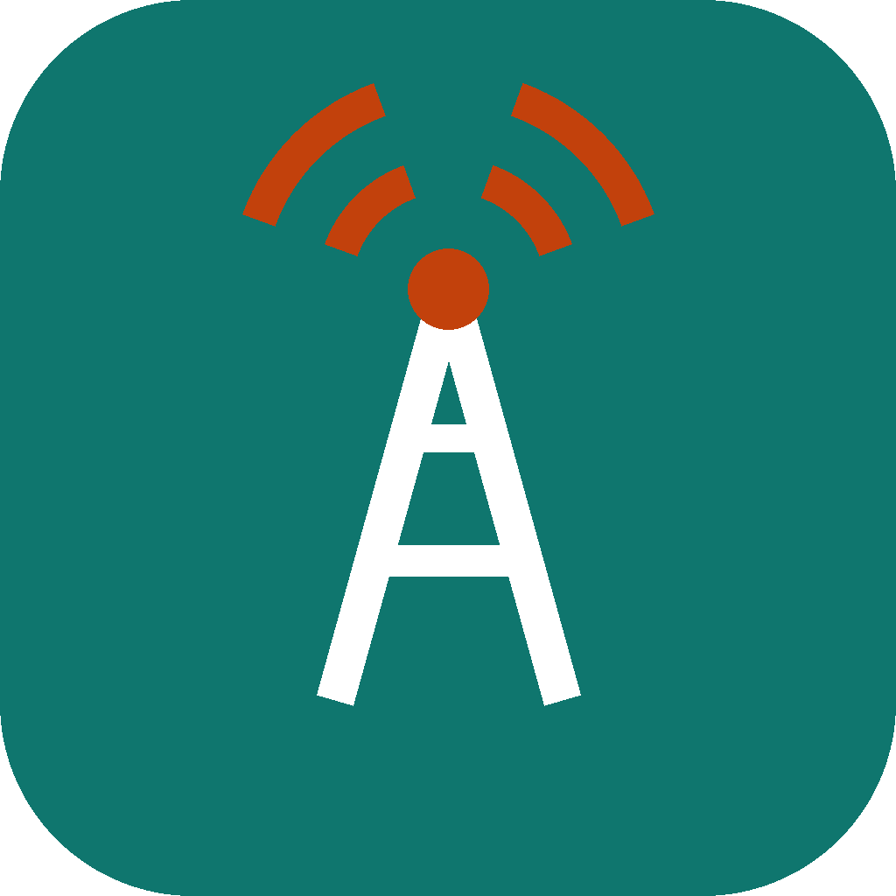

# RTN

> "someone should just rewrite MTN in Rust"
> — [@uthman_dev](https://x.com/uthman_dev/status/2110243209444298778)

So we did not rewrite anybody's network. We wrote a small one of our own, in Rust, and called it
RTN. It is a joke that happens to work: subscribers, airtime, data bundles, per-second calls,
SMS that wait for your phone to come back on, `*123#`, and a console that shows it all moving.

RTN is its own thing. It has no connection to any real operator, uses none of their names, logos
or colours, and its numbers (`234999…`) and SIMs (MCC 999) sit in ranges set aside for test and
private networks.



## What is in it

| Part | Where | Written in |
|---|---|---|
| Network core: subscriber registry, online charging with an idempotent ledger, USSD gateway, SMS centre, traffic simulator | [`core/`](core/) | Rust |
| HTTP/JSON API and the `rtn` CLI | `core/crates/rtn-api`, `core/crates/rtn-cli` | Rust |
| C ABI for in-process callers | `core/crates/rtn-ffi` | Rust |
| Self-service app (web, web-server, Android) and the operator console | [`app/`](app/) | [Dartvel](https://dartvel.dev) 0.12.1 |

The plan, and what comes after milestone 1, is in [docs/PLAN.md](docs/PLAN.md). Every API route
is in [docs/API.md](docs/API.md).

## Run it

You need Rust (stable). For the app you also need Flutter 3.47+ and the Dartvel CLI
(`dart pub global activate dartvel_cli`).

```sh
./demo.sh              # the core, 50 subscribers, live traffic, and the app
./demo.sh --core-only  # just the core and its API
```

Then open:

- **http://127.0.0.1:8740/** and sign in as `0999 000 0001` with PIN `1234` (lines 1 to 5 all use it):
  balances, bundles, transfers, loans, messages and history.
- **http://127.0.0.1:8740/ussd**: a dial pad. Dial `*123#` and work through the menu, from the
  keypad or your keyboard.
- **http://127.0.0.1:8740/console**: the operator console (the password is printed when the
  demo starts): live traffic every two seconds, the subscriber registry, rating plans and bundles.

Or talk to the core directly:

```sh
export RTN_API=http://127.0.0.1:8700 $(grep RTN_ADMIN_TOKEN .demo/secrets.env)
./core/target/release/rtn subscribers
./core/target/release/rtn ussd 2349990000001 '*123#'
./core/target/release/rtn sms 2349990000001 2349990000002 'Abeg send the address'
```

## How it fits together

```
 browser / Android ──► Dartvel app (pages + backend functions) ──HTTP──► rtn-api ──► rtn-core
                                                                           ▲
                         rtn CLI ─────────────────────────────────HTTP─────┘
                         any C/Dart FFI caller ──► rtn-ffi ──► rtn-core (in process)
```

- The **core** is one `Network` value with no I/O and no clock of its own, so it is easy to test:
  the same calls in the same order always give the same network.
- **Charging** is online: a call reserves airtime before it starts and is billed per second when
  it ends; data uses bundles first, then airtime; every operation carries a request id, so a retry
  never charges twice. Every balance change is a ledger entry, and property tests check that each
  account always equals the sum of its ledger and that money is conserved across the network.
- The **app** never holds the operator's token. Pages call Dartvel backend functions; those call
  the core with the subscriber's token or, for the console, with the token the server keeps.
  Every screen has its own URL and is rendered on the server by Dartvel's one render path, so it
  is selectable, searchable with Ctrl+F, keyboard-navigable and read by screen readers.

## Develop

```sh
cd core && cargo test --workspace && cargo clippy --workspace --all-targets -- -D warnings
cd app && flutter test && flutter analyze
cd app && dartvel build web-server    # one binary: build/server
cd app && dartvel build apk
```

## Licence

MIT. See [LICENSE](LICENSE).
