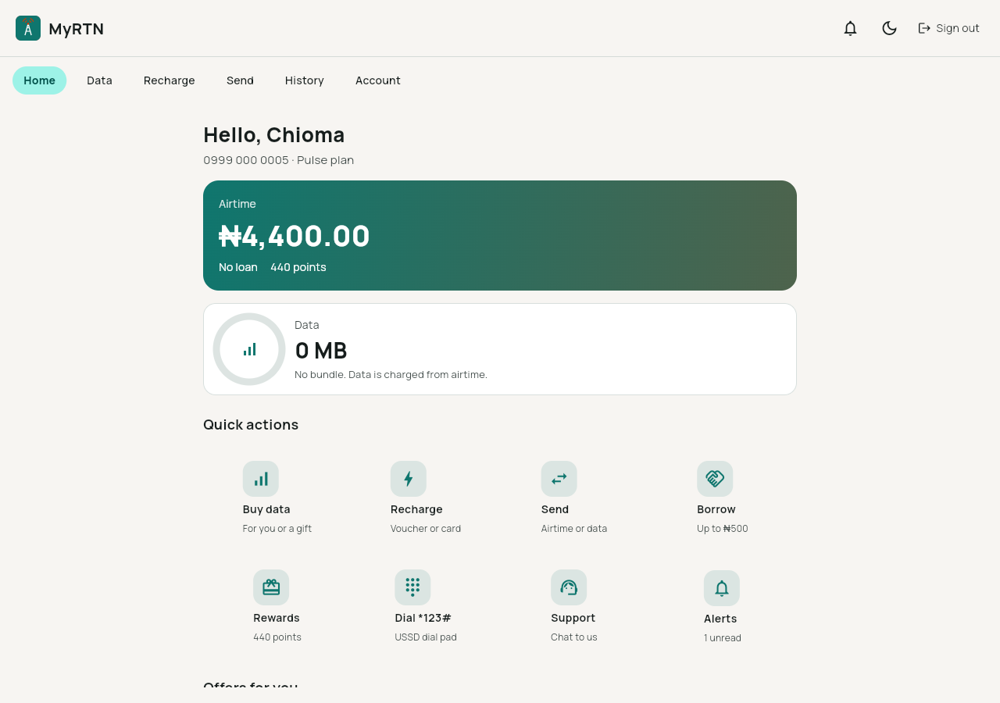
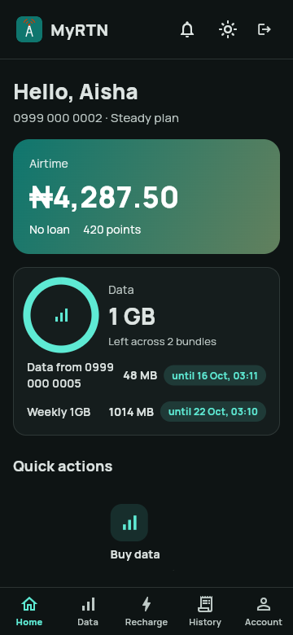
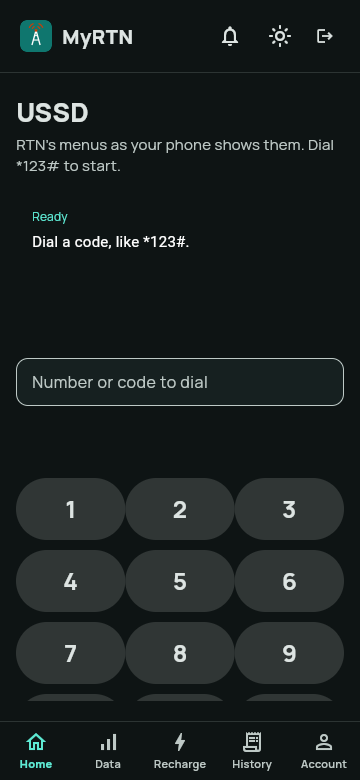
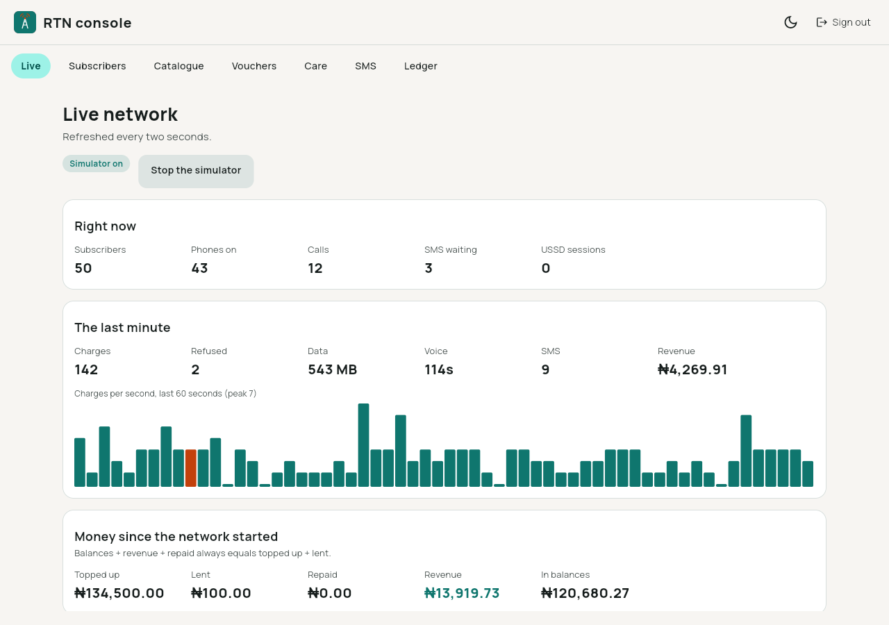

# RTN

A playful but genuinely working mini mobile-network operator stack: a Rust core and Dartvel apps.

RTN exists because [someone said a telco should just be rewritten in Rust](https://x.com/uthman_dev/status/2110243209444298778). So we did. RTN is an independent open-source project and is not affiliated with any mobile network operator.

Its numbers (`0999 …`, `234999…`) and SIMs (MCC 999) sit in ranges set aside for testing and
private networks, and it uses no operator's name, logo or colours: RTN is teal and rust.



| | | |
|---|---|---|
|  |  |  |

More in [docs/screens](docs/screens/).

## What is in it

| Part | Where | Written in |
|---|---|---|
| The network: subscriber registry, online charging with an idempotent ledger, USSD gateway, SMS centre, one-time sign-in codes, vouchers, loyalty, customer care, traffic simulator | [`core/`](core/) | Rust |
| A durable node: every change journalled before it is answered, replayed exactly on restart | `rtn_core::node` | Rust |
| HTTP API and the `rtn` CLI | `core/crates/rtn-api`, `core/crates/rtn-cli` | Rust |
| C ABI for in-process callers | `core/crates/rtn-ffi` | Rust |
| **MyRTN**, the self-service app, and the operator console | [`app/`](app/) | [Dartvel](https://dartvel.dev) 0.12.2 |

MyRTN is what an operator's self-care app does: sign in with your number and a code sent by SMS;
see airtime, a data meter and every bundle; buy data for yourself or as a gift; recharge with a
voucher or a card; send airtime or share data; borrow; collect and spend loyalty points; read
every transaction with a receipt; get notifications; chat to care; dial `*123#`; and manage the
line, the PIN and the SIM. The console runs the network: live traffic and money, subscribers,
the catalogue, vouchers, the care desk, the SMS centre and the ledger.

The plan and what milestones 1 and 2 became are in [docs/PLAN.md](docs/PLAN.md). Every route and
the core's RPC are in [docs/API.md](docs/API.md).

## Run it

You need Rust (stable), Flutter 3.47+ with Dart 3.13+, the Dartvel CLI
(`dart pub global activate dartvel_cli`) and Chrome or Chromium for the web build.

```sh
./demo.sh              # MyRTN with the core inside it, 50 subscribers, live traffic
./demo.sh --http       # the same, with the core as its own process (rtn serve)
./demo.sh --core-only  # just the core and its API
```

Then open **http://127.0.0.1:8740/**, sign in as any of `0999 000 0001` to `0999 000 0050`
(the demo shows the SMS code on the page; transfers on lines 0001 to 0005 use PIN `1234`), or go
to **/operator** with the console password `demo.sh` prints. MockPay's card `4242 4242 4242 4242`
is approved and `4000 0000 0000 0002` is declined; no real money moves.

The network lives in `.demo/network` and survives a restart; delete `.demo/` for a fresh one.

## How it fits together

```
 browser / Android ──► MyRTN (Dartvel: pages, backend functions, sessions)
                          │  in-process: librtn_ffi via dart:ffi ──► rtn-core + journal
                          └─ or HTTP: POST /v1/admin/rpc ──► rtn serve ──► rtn-core + journal
 rtn CLI, anything else ──► rtn-api (HTTP/JSON)
```

- The **core** is one `Network` value with no I/O, no clock and no random source of its own:
  callers pass the time and, where a code or PIN is made, a nonce. The same calls in the same
  order always give the same network, which is what lets the journal replay it exactly.
- **Charging** is online and idempotent: every operation carries a request id, a retry is never
  charged twice, and every balance change is a ledger entry. Property tests hold each account to
  the sum of its ledger and the network to conservation of money.
- **MyRTN** never holds the operator's token, and no page names a number it acts on: a backend
  function acts on the line of the Dartvel session that called it, behind a policy.

## Develop

```sh
cd core && cargo test --workspace && cargo clippy --workspace --all-targets -- -D warnings
cd core && cargo build --release            # the app's tests load librtn_ffi from here
cd app && flutter test && flutter analyze
cd app && dartvel build web-server          # one binary: build/server
```

## Licence

MIT. See [LICENSE](LICENSE).
